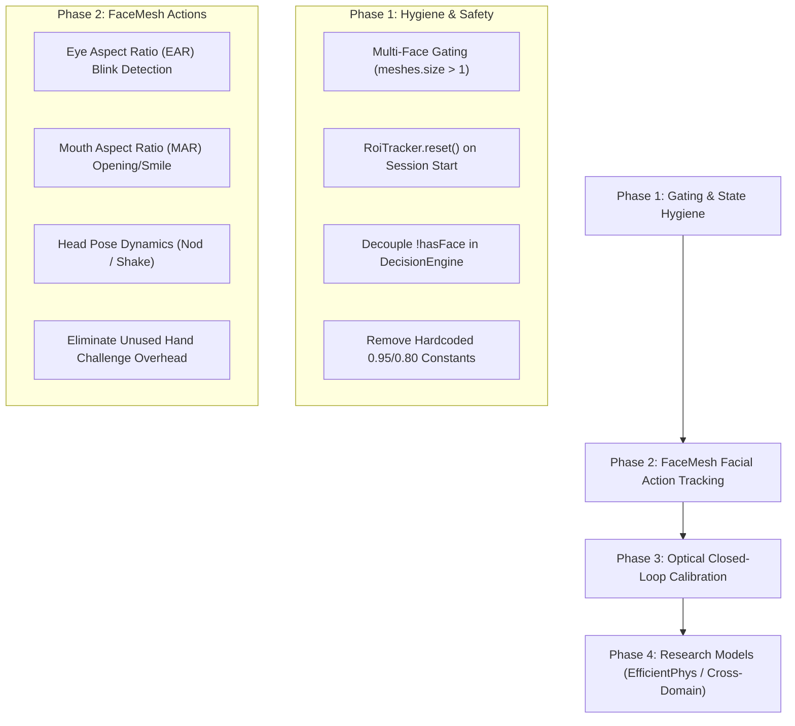

# EdgePPG — Machine Learning Status, Integration Audit & FaceMesh Action Plan

> **Document Version:** 1.0.0  
> **Target Device:** vivo / iQOO 15 (Qualcomm Snapdragon 8 Elite, Android 15 / API 35+)  
> **Repository:** `E:\EdgePPG`  
> **Schema Version:** `edgeppg-1.0` (Frozen 28-Feature Schema)

---

## 1. Executive Summary

EdgePPG provides remote human trust, liveness attestation, and Video KYC verification executed **100% on-device** on the iQOO 15. The core pipeline is implemented in pure **Kotlin**, requiring **zero Termux, zero Python runtime, and zero external PC dependencies** during verification.

This document compiles:
1. **The Current Implementation State** across the sensing, rPPG DSP, ML inference, and attestation modules.
2. **The Identified Integration Gaps** discovered during the adversarial runtime truth audit.
3. **The Implementation Roadmap & Sequence** to resolve these gaps.
4. **The Google FaceMesh 468-Point Mathematical Framework** for pure-facial gesture and action tracking (replacing external hand models).
5. **The Research Progression Pathway** for future learned models (EfficientPhys, Cross-Domain PAD, OR-PAD).

---

## 2. System Status Matrix

| Subsystem | Component | Implementation File | Status | Notes |
|---|---|---|---|---|
| **Camera Acquisition** | CameraX / Camera2 Interop | [`CameraSession.kt`](file:///E:/EdgePPG/android/app/src/main/kotlin/com/edgeppg/app/capture/CameraSession.kt) | **COMPLETE** | 1080p, `YUV_420_888`, AE/AWB convergence locking. |
| **Face Landmarker** | ML Kit Face Mesh (468 points) | [`RoiTracker.kt`](file:///E:/EdgePPG/android/app/src/main/kotlin/com/edgeppg/app/capture/RoiTracker.kt) | **COMPLETE** | 468 3D points, runs every 3 frames with EMA smoothing. |
| **ROI Extraction** | Geometric Fractional ROIs | [`RoiTracker.kt`](file:///E:/EdgePPG/android/app/src/main/kotlin/com/edgeppg/app/capture/RoiTracker.kt) | **COMPLETE** | Forehead, Left Cheek, Right Cheek bounding fractions. |
| **Pixel Sampling** | Direct YUV Plane Conversion | [`RoiTracker.kt`](file:///E:/EdgePPG/android/app/src/main/kotlin/com/edgeppg/app/capture/RoiTracker.kt) | **COMPLETE** | ITU-R BT.601 integer math, zero-allocation hot path. |
| **rPPG DSP (POS)** | Plane-Orthogonal-to-Skin | [`RppgClient.kt`](file:///E:/EdgePPG/android/app/src/main/kotlin/com/edgeppg/app/rppg/RppgClient.kt) | **COMPLETE** | Multi-ROI skin reflection projection (Wang et al. 2017). |
| **rPPG DSP (CHROM)** | Chrominance Method | [`RppgClient.kt`](file:///E:/EdgePPG/android/app/src/main/kotlin/com/edgeppg/app/rppg/RppgClient.kt) | **COMPLETE** | de Haan & Jeanne 2013 chrominance pulse extraction. |
| **Spectral Analysis** | 256-pt Radix-2 FFT | [`RppgClient.kt`](file:///E:/EdgePPG/android/app/src/main/kotlin/com/edgeppg/app/rppg/RppgClient.kt) | **COMPLETE** | Hann windowing, 0.7–4.0 Hz band (42–240 BPM). |
| **Physiological Check**| Multi-Method Correlation | [`RppgClient.kt`](file:///E:/EdgePPG/android/app/src/main/kotlin/com/edgeppg/app/rppg/RppgClient.kt) | **COMPLETE** | Pearson correlation between POS and CHROM ($r \approx 0.98$). |
| **Passive PAD** | 3D Depth Planarity Collapse | [`PhoneScreenDetector.kt`](file:///E:/EdgePPG/android/app/src/main/kotlin/com/edgeppg/app/capture/PhoneScreenDetector.kt) | **COMPLETE** | Replay screen planarity & bezel luminance gradient. |
| **Device Recognition** | ML Kit Image Labeling | [`PhoneScreenDetector.kt`](file:///E:/EdgePPG/android/app/src/main/kotlin/com/edgeppg/app/capture/PhoneScreenDetector.kt) | **COMPLETE** | Detects phones, screens, and monitors in frame. |
| **Behavioral Engine** | Gaze & Head Pose Tracking | [`GazeEstimator.kt`](file:///E:/EdgePPG/android/app/src/main/kotlin/com/edgeppg/app/behavior/GazeEstimator.kt), [`HeadPoseSolver.kt`](file:///E:/EdgePPG/android/app/src/main/kotlin/com/edgeppg/app/behavior/HeadPoseSolver.kt) | **COMPLETE** | Iris gaze tracking and 3D Euler head orientation. |
| **Hand Landmarker** | Gesture Matching | N/A | **GAP / TO-DO** | No Hand model on frames; hand challenges time out. |
| **Optical Stimulus** | Optical Flash Overlay | [`OpticalFlashOverlay.kt`](file:///E:/EdgePPG/android/app/src/main/kotlin/com/edgeppg/app/optical/OpticalFlashOverlay.kt) | **PARTIAL** | UI flashes, but closed-loop skin response is uncalibrated. |
| **Feature Assembly** | Frozen 28-Feature Vector | [`RowAssembler.kt`](file:///E:/EdgePPG/android/app/src/main/kotlin/com/edgeppg/app/features/RowAssembler.kt) | **COMPLETE** | Schema `edgeppg-1.0` parity validated with PC pipeline. |
| **On-Device ML** | 300-Tree Pure Kotlin RF | [`NativeTreeMlClient.kt`](file:///E:/EdgePPG/android/app/src/main/kotlin/com/edgeppg/app/features/NativeTreeMlClient.kt) | **COMPLETE** | Pure bytecode evaluation in $<0.1\text{ ms}$; Platt calibrated. |
| **Security Gates** | Deterministic Decision Engine | [`DecisionEngine.kt`](file:///E:/EdgePPG/android/app/src/main/kotlin/com/edgeppg/app/gates/DecisionEngine.kt) | **COMPLETE** | Enforces `LIVE`, `SPOOF`, `UNCERTAIN` hierarchy. |
| **Attestation** | Hardware Keystore ECDSA | [`IntegrityManager.kt`](file:///E:/EdgePPG/android/app/src/main/kotlin/com/edgeppg/app/integrity/IntegrityManager.kt) | **COMPLETE** | Signs canonical transcript via `SHA256withECDSA`. |
| **PC Verification** | HTTP Verification Transport | [`verifier/server.py`](file:///E:/EdgePPG/verifier/server.py) | **COMPLETE** | Independent signature and replay nonce verifier. |

---

## 3. Identified Gaps & Integrity Deficiencies

During the runtime integration audit, four concrete deficiencies were identified in the existing code:

1. **Multi-Face Rejection Defect:**
   * *Location:* [`RoiTracker.kt:122`](file:///E:/EdgePPG/android/app/src/main/kotlin/com/edgeppg/app/capture/RoiTracker.kt#L122)
   * *Finding:* When multiple people are visible, `RoiTracker` takes `meshes[0]` without checking `meshes.size > 1`.
   * *Impact:* A second person in frame does not halt the session. Single-person KYC requires that `meshes.size > 1` pause processing and route to `UNCERTAIN`.

2. **Session Reset State Leakage:**
   * *Location:* [`RoiTracker.kt:77-83`](file:///E:/EdgePPG/android/app/src/main/kotlin/com/edgeppg/app/capture/RoiTracker.kt#L77-L83)
   * *Finding:* `RoiTracker` does not provide a `reset()` method. `lastRois`, `smooth`, and `facePresent` persist across sessions.
   * *Impact:* Starting a second session pointed at an empty wall can inherit `facePresent = true` from the previous session.

3. **Quality-Gate Physiological Override Bug:**
   * *Location:* [`DecisionEngine.kt:106-116`](file:///E:/EdgePPG/android/app/src/main/kotlin/com/edgeppg/app/gates/DecisionEngine.kt#L106-L116)
   * *Finding:* `!inputs.hasFace` is grouped with `contaminationFlag` under transient quality overrides. If ML probability is high, the gate can declare `LIVE` when no face is present.
   * *Impact:* Violates the foundational invariant: *no face $\to$ never LIVE*.

4. **Hardcoded Fallbacks in Session Controller:**
   * *Location:* [`SessionController.kt:245-257`](file:///E:/EdgePPG/android/app/src/main/kotlin/com/edgeppg/app/session/SessionController.kt#L245-L257)
   * *Finding:* Substitutes `0.95f` for `face_confidence` and `0.80f` for `face_quality` when signals are missing.
   * *Impact:* Violates Rule 4.1 (*No fabricated data*). Missing observations must be represented as `Float.NaN`.

---

## 4. Prioritized Execution Sequence



### Implementation Sequence:
1. **Step 1: Core Integrity Fixes**
   * Update `RoiTracker.kt` to record `faceCount`. If `faceCount > 1`, set `multipleFaces = true` and halt downstream processing.
   * Expose `RoiTracker.reset()` and call it in `MainActivity.startSession()`.
   * Update `DecisionEngine.kt` to immediately return `UNCERTAIN("no-face")` when `!hasFace`.
   * Pass strictly observed values or `Float.NaN` into `RowAssembler.Inputs`.
2. **Step 2: FaceMesh Action Tracking Engine**
   * Implement real-time EAR and MAR geometry estimators on the 468 landmarks.
   * Connect active blink and smile challenges into `ChallengeEngine.kt` and `BehaviourRunner.kt`.
3. **Step 3: Optical Reflection Calibration**
   * Sample the forehead YUV buffer before and during the fullscreen flash to compute real luminance deltas.
4. **Step 4: Research Pipeline Progression**
   * Benchmark EfficientPhys and learned cross-domain PAD on PC before selecting mobile deployment candidates.

---

## 5. Google FaceMesh 468-Point Mathematical Framework

### Why Pure-Facial Actions Outperform Hand Tracking on Mobile
1. **Zero Extra Memory & Thermal Footprint:** ML Kit FaceMesh is already loaded in memory for rPPG ROI extraction. Reusing its 468 points for action tracking adds **zero MB** to the APK and zero extra inference passes.
2. **Ergonomics:** Forcing a user to hold a hand in front of their face blocks the rPPG pulse signal on the cheeks and forehead.
3. **Continuous Tracking:** Facial micro-actions are tracked continuously at 30 fps directly from the face geometry.

---

### Canonical FaceMesh Topology

```
                     10 (Forehead Top)
               70         336 (Eyebrows)
             159           386
         33 ◉ 144         374 ◉ 263 (Eyes)
                    1 (Nose Tip)
                61 ── 13 ── 291
                   ── 14 ──     (Mouth / Lips)
                   152 (Chin)
```

---

### Mathematical Formulations for Action Verification

#### A. Natural Blink Detection via Eye Aspect Ratio (EAR)
* **Landmark Indices:**
  * **Left Eye:** Upper lid ($p_{159}, p_{160}$), Lower lid ($p_{144}, p_{145}$), Corners ($p_{33}, p_{133}$).
  * **Right Eye:** Upper lid ($p_{386}, p_{387}$), Lower lid ($p_{373}, p_{374}$), Corners ($p_{362}, p_{263}$).
* **Equation:**
  $$\text{EAR} = \frac{\|p_{159} - p_{145}\| + \|p_{160} - p_{144}\|}{2 \cdot \|p_{33} - p_{133}\|}$$
* **Thresholds:**
  * **Eyes Open:** $\text{EAR} \in [0.28, 0.36]$
  * **Blink State:** $\text{EAR} < 0.18$
* **Liveness Defense:** A static photo, printed mask, or looped screen replay lacking natural involuntary blinks fails the `MOTION_BLINK_CHECK` gate immediately.

---

#### B. Mouth Movement & Smile Detection via Mouth Aspect Ratio (MAR)
* **Landmark Indices:**
  * **Inner Lips:** Upper inner lip ($p_{13}$), Lower inner lip ($p_{14}$).
  * **Mouth Corners:** Left corner ($p_{61}$), Right corner ($p_{291}$).
* **Equation:**
  $$\text{MAR} = \frac{\|p_{13} - p_{14}\|}{\|p_{61} - p_{291}\|}$$
* **Thresholds:**
  * **Mouth Closed / Neutral:** $\text{MAR} < 0.20$
  * **Mouth Open (Say "Ah"):** $\text{MAR} > 0.50$
  * **Smile Gesture:** Inter-corner width ratio increases relative to eye canthi:
    $$\text{Smile Ratio} = \frac{\|p_{61} - p_{291}\|}{\|p_{33} - p_{263}\|} > 0.55$$

---

#### C. Head Pose Dynamics (Euler Angles)
* **Landmark Indices:** Nose tip ($p_{1}$), Chin ($p_{152}$), Left Eye Corner ($p_{33}$), Right Eye Corner ($p_{263}$), Mouth Corners ($p_{61}, p_{291}$).
* **Equations (Implemented in [`HeadPoseSolver.kt`](file:///E:/EdgePPG/android/app/src/main/kotlin/com/edgeppg/app/behavior/HeadPoseSolver.kt)):**
  $$\begin{aligned}
  \text{Yaw} &= \arctan2(x_{\text{nose}} - x_{\text{mid}}, z_{\text{mid}} - z_{\text{nose}}) \times \frac{180^\circ}{\pi} \\
  \text{Pitch} &= \arctan2(y_{\text{nose}} - y_{\text{mid}}, z_{\text{mid}} - z_{\text{nose}}) \times \frac{180^\circ}{\pi} \\
  \text{Roll} &= \arctan2(y_{\text{right}} - y_{\text{left}}, x_{\text{right}} - x_{\text{left}}) \times \frac{180^\circ}{\pi}
  \end{aligned}$$
* **Challenges Tracked:**
  * **Head Turn Left:** $\text{Yaw} > +14^\circ$
  * **Head Turn Right:** $\text{Yaw} < -14^\circ$
  * **Head Tilt Up / Down:** $\text{Pitch} > +10^\circ$ or $<-10^\circ$
  * **Head Nod ("Yes"):** Pitch cycle $(\text{Pitch}_{\text{max}} - \text{Pitch}_{\text{min}} > 16^\circ)$ within a 1.2-second window.
  * **Head Shake ("No"):** Yaw cycle $(\text{Yaw}_{\text{max}} - \text{Yaw}_{\text{min}} > 20^\circ)$ within a 1.2-second window.

---

#### D. Iris Gaze Vector Estimation
* **Landmark Indices:** Iris center relative to outer/inner canthi ($p_{33}, p_{133}$ and $p_{362}, p_{263}$).
* **Tracking:**
  * Horizontal ratio $< 0.42 \implies$ **LOOK LEFT**
  * Horizontal ratio $> 0.58 \implies$ **LOOK RIGHT**
  * Ratio $\in [0.42, 0.58] \implies$ **LOOK CENTER**

---

## 6. Research Progression Roadmap

Once the production pipeline integrity is sealed, research workstreams will proceed according to the priority register:

```text
1. POS / CHROM DSP (P0 Baseline)          → [COMPLETE on Android]
2. Random Forest on 28 Features (P1)     → [COMPLETE on Android]
3. XGBoost Challenger on 28 Features (P1) → [COMPLETE on PC]
4. EfficientPhys Neural rPPG (P1)        → [Research / Offline Benchmark]
5. Optical Reflection PAD (OR-PAD) (P2)   → [Research Experimentation]
6. Cross-Domain Generalization (P2)      → [Dataset Protocol Evaluation]
7. PRNU Camera Forensics (P2/P3)         → [Post-Competition Exploration]
```

### Research Guardrails
* **No Premature NPU / JNI Porting:** Pure Kotlin evaluation is currently $<0.1\text{ ms}$; NPU acceleration is unnecessary until a neural backbone (such as EfficientPhys) is selected.
* **Preserve Frozen 28-Feature Schema:** All research models must ingest the validated `edgeppg-1.0` input vector without adding ad-hoc features.
* **Separation of Concerns:** Research diagnostics remain outside the APK production transcript envelope.
